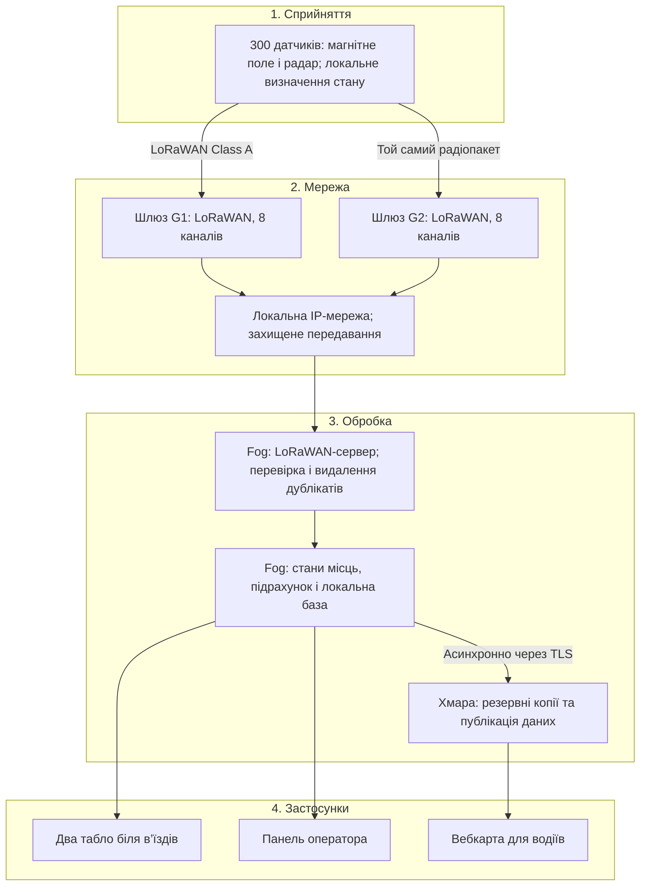

# Розумне паркування: система визначення зайнятості 300 місць

Аналітично-проєктна робота. Документ описує архітектуру та вимоги до майбутньої системи; програмування і фактичне розгортання не виконуються.

## 1. Мета та вихідні припущення

Мета — показувати водіям кількість доступних місць і їх розташування, а оператору — зайнятість, історію змін та несправності обладнання.

Оскільки реальний план паркінгу не надано, прийнято такі **проєктні припущення**:

| Параметр | Прийняте значення |
|---|---|
| Тип об’єкта | Відкритий наземний міський паркінг без суцільного навісу |
| Кількість місць | 300, ідентифікатори P001–P300 |
| Геометрія | Прямокутник 180 × 100 м, площа 18 000 м² разом із проїздами й допоміжними зонами |
| Організація | Три умовні сектори по 100 місць, два в’їзди |
| Інфраструктура | Наявні опори, електроживлення, приміщення оператора та можливість прокласти локальну мережу |
| Навантаження | У середньому 10 відвідувань на місце за добу; одне відвідування — заїзд і виїзд |
| Короткочасний пік | До 30 змін стану за хвилину на весь паркінг |
| Обсяг повідомлення | Для розрахунку — 12 байтів прикладних даних, приблизно 25 байтів LoRaWAN-кадру без додаткових MAC-команд |
| Вимога до затримки | Не менше 95% змін мають з’являтися на локальному табло протягом 60 с від фізичного заїзду/виїзду за штатного навантаження |
| Втрата інтернету | Локальне визначення зайнятості й табло продовжують працювати |

Це система інформування, а не засіб аварійної безпеки чи гарантія резервування місця. Оплата, розпізнавання номерів і керування шлагбаумом не входять до обсягу проєкту. Для багаторівневого або розосередженого паркінгу потрібен інший розрахунок покриття.

## 2. Визначення зайнятості: порівняння двох варіантів

| Критерій | Магнітне визначення | Ультразвукове визначення |
|---|---|---|
| Принцип | Вимірювання зміни магнітного поля під впливом металевих частин автомобіля | Вимірювання відстані за відбитим звуковим імпульсом; поява автомобіля змінює відстань |
| Типове встановлення | На покритті або в покритті, у визначеній виробником точці місця | Над місцем, із направленням на автомобіль; потрібне кріплення на стелі чи конструкції |
| Переваги | Не потребує освітлення, камер і конструкцій над кожним місцем | Дає вимірювання відстані; зручне для критого паркінгу з готовою стелею |
| Ризики | Вплив арматури, сусідніх автомобілів, магнітних перешкод; потрібне калібрування | Забруднення поверхні, опади, сторонні предмети та неправильний кут можуть заважати вимірюванню |
| Експлуатація | Потрібен захист від коліс, снігоприбиральної техніки й пошкодження кріплення | Потрібні очищення, доступ до висотного обладнання та перевірка зони вимірювання |
| Приклад | MOKO LW009-SM: комбінований магнітний датчик із радарним підтвердженням [1] | Milesight EM310-UDL: ультразвуковий пристрій, який виробник описує для критого паркінгу [2] |
| Ціновий орієнтир | €196 без ПДВ за LW009-SM [3] | €108 за EM310-UDL у каталозі; податкові умови цієї позиції треба уточнити [4] |

**Обране рішення:** 300 наземних LW009-SM або еквівалентів із магнітним визначенням та незалежним радарним підтвердженням. Це саме комбінований пристрій, а не чистий магнітометр. Виробник підтверджує наявність обох способів детекції [1]. Відсутність навісу робить монтаж ультразвукових пристроїв над 300 місцями менш зручним: нижча ціна сенсора не враховує додаткові конструкції.

Перед закупівлею всієї партії передбачено пілот на 10 місцях із різними автомобілями, у тому числі високими та малими, і з перевіркою впливу сусідніх місць. Точність не вважається доведеною рекламними характеристиками.

Сенсор локально визначає зміну стану, застосовує штатну фільтрацію та передає подію. Раз на 15 хвилин передбачено повідомлення про поточний стан і працездатність зі зсувом часу між вузлами. Підтримку такого інтервалу, формат кадру й швидкість детекції необхідно підтвердити для конкретної версії пристрою до закупівлі.

## 3. Архітектура: чотири рівні

Стрілки від датчиків означають можливість приймання обома шлюзами. Це не два окремі передавання одного повідомлення. Локальна класифікація є edge-обробкою всередині сенсора; на схемі сам пристрій віднесено до рівня сприйняття. На fog-сервері працюють мережевий сервер і прикладна обробка.

## 4. Склад системи

| Пристрій / компонент | Кількість | Що вимірює або робить | Де розміщено |
|---|---:|---|---|
| Наземний датчик LW009-SM або еквівалент | 300 | Визначає присутність автомобіля, передає стан і діагностику | По одному на кожне місце, за схемою монтажу виробника |
| Запасні датчики | 15 | Заміна несправних пристроїв; 5% резерву | Склад оператора, у мережі не працюють |
| Зовнішній шлюз Milesight UG67 EU868 або еквівалент | 2 | Приймає LoRaWAN-пакети, передає їх локальному серверу | Дві окремі опори, висота антен орієнтовно 5 м |
| Мережевий комутатор, PoE-живлення, захист ліній | 1 комплект | Локальний IP-зв’язок, живлення шлюзів, захист кабельних вводів | Захищені шафи та приміщення оператора |
| Fog-сервер із SSD | 1 | Мережевий сервер, база станів, підрахунок, журнал і локальний інтерфейс | Приміщення оператора |
| UPS | 2 | Резерв живлення з розподілом шлюзів між двома гілками | Технічні шафи; потужність уточнюється за навантаженням |
| Вуличне інформаційне табло | 2 | Показує підтверджені вільні місця та недоступність даних | Біля двох в’їздів |
| Хмарний сервіс | 1 логічний сервіс | Публікація карти та резервні копії | Віддалений центр обробки даних |

Наявне робоче місце оператора використовується повторно. Кожен датчик прив’язується до місця, координат і сектора через реєстр обладнання. Переміщення датчика потребує оновлення цього реєстру.

## 5. Протокол і мережева топологія

Обрано **приватну LoRaWAN-мережу з топологією «зірка зірок»** [5]. Датчики передають невеликі повідомлення безпосередньо шлюзам; між датчиками немає ретрансляції. Обидва шлюзи підключені до одного локального мережевого сервера. Він видаляє дублікати прийнятих пакетів і передає перевірені дані прикладному сервісу.

Обґрунтування для 300 вузлів:

- батарейні датчики передають короткі події, а не відео;
- не потрібно прокладати кабель до кожного місця;
- не потрібна окрема SIM-картка на кожен сенсор;
- 8-канальні шлюзи приймають повідомлення різних вузлів; їх достатність перевіряється за ефірним часом, а не лише рекламною кількістю пристроїв;
- Class A підходить для подій від датчиків; постійний швидкий канал команд до сплячого сенсора не потрібен.

Wi-Fi вимагав би іншого енергетичного бюджету батарейних вузлів; Zigbee — планування mesh-маршрутів і живлення ретрансляторів; NB-IoT створював би залежність кожного сенсора від оператора. Для компактного паркінгу з локальною інфраструктурою власна LoRaWAN-мережа відповідає обраному сценарію.

Для розрахунку прийнято EU868, 125 кГц та роботу переважно на SF7–SF9. Частотні канали, дозволену потужність і правила використання спектра необхідно погодити з вимогами країни встановлення. Наведений далі duty cycle 1% — розрахункова умова для відповідної підсмуги, а не універсальне правило для всього діапазону [7].

### 5.1. Перевірка навантаження

Середня кількість повідомлень за добу без повторів і службового трафіку:

- зміни зайнятості: 300 × 10 відвідувань × 2 події = **6 000**;
- періодичні повідомлення: 300 × 24 × 4 = **28 800**;
- разом: **34 800 повідомлень/добу**, або 1 450/год, приблизно 0,403/с.

Для розрахункового кадру 25 байтів за BW125, CR4/5, преамбули 8 символів, явного заголовка й CRC ефірний час становить приблизно 61,7 мс на SF7 та 205,8 мс на SF9. Це розрахунок стандартного LoRa-кадру, а не вимірювання обраного сенсора; довший фактичний payload потребує перерахунку.

У консервативному сценарії, коли всі повідомлення мають SF9, середній сумарний час передавання за годину:

**1 450 × 0,2058 = 298,4 с.**

За рівномірного використання восьми каналів середнє запропоноване навантаження:

**298,4 / (8 × 3 600) ≈ 1,04%.**

За піку 30 подій/хв і 20 періодичних повідомлень/хв отримаємо:

**50 × 0,2058 / (8 × 60) ≈ 2,14%.**

Це оцінка навантаження, не гарантія доставки: колізії, нерівномірні канали, сторонні мережі, повтори та різні SF впливають на результат. За використання лише трьох каналів значення зростуть до приблизно 2,76% і 5,72%. Потрібно підтвердити підтримку восьми каналів кінцевими вузлами.

Один вузол у середньому передає 116 повідомлень/добу, що на SF9 займає близько 23,9 с/добу. Проте середнє значення не скасовує короткочасних обмежень: після кадру 0,2058 с за duty cycle 1% можливе очікування близько 20,4 с у тій самій підсмузі. Саме тому не встановлено нереалістичну вимогу оновлення кожного місця за 1 секунду.

Основний трафік — непідтверджені uplink-повідомлення; постійні ACK для всіх пакетів не плануються. Періодичне повідомлення містить актуальний стан і виправляє пропущену подію. Реальні можливості повторів та їх вплив на затримку й батарею перевіряються в пілоті. Другий шлюз не подвоює доступний радіоефір, адже обидва приймають ті самі передачі.

## 6. Розрахунок кількості шлюзів і розміщення

UG67 — зовнішній IP67-шлюз із вісьмома каналами [6]. Його заявлену далекодійність не використовуємо як доказ покриття: датчик розташований біля землі й під автомобілем.

### 6.1. Геометрія

Вводимо координати: південно-західний кут майданчика — (0; 0), протилежний — (180; 100), одиниця — метр.

Попередньо прийнятий **ефективний радіус 200 м** — припущення для планування, яке потрібно підтвердити на місці для SF7–SF9.

Один шлюз у центрі (90; 50) має максимальну відстань до кута:

**d = √(90² + 50²) ≈ 103 м < 200 м.**

Отже, геометричний мінімум за цим припущенням — один шлюз. Розрахунок трафіку також не вимагає другого шлюзу лише через наявність 300 датчиків.

### 6.2. Прийняті дві точки

| Шлюз | Координати | Висота антени | Призначення |
|---|---|---|---|
| G1 | (45; 50) | Орієнтовно 5 м | Основний напрям приймання західної частини, резерв для східної |
| G2 | (135; 50) | Орієнтовно 5 м | Основний напрям приймання східної частини, резерв для західної |

Максимальна відстань до найближчого шлюзу:

**d_near = √(45² + 50²) ≈ 67,3 м.**

Якщо один шлюз відмовив, найдальший кут від іншого:

**d_backup = √(135² + 50²) ≈ 144 м < 200 м.**

**Підсумкове проєктне рішення: 2 шлюзи — один достатній за розрахунком покриття й навантаження, другий додається для просторового резервування.** Обидва працюють одночасно. Датчики не прив’язуються жорстко до груп по 150.

Опори обираються з урахуванням відкритого огляду, доступу до живлення, безпечного монтажу й віддалення від великих металевих перешкод. На повністю заповненому майданчику перевіряють приймання з усіх 300 місць через кожен шлюз окремо. Проєктна мета — запас лінії не менше 10 дБ відносно порога демодуляції для обраного режиму та виконання вимоги затримки. Якщо цього немає, змінюють положення антен або додають третій шлюз. Третій шлюз у базовий кошторис не включено.

## 7. Де виконувати обробку: edge, fog чи хмара

| Рівень | Функція | Причина вибору |
|---|---|---|
| Edge — датчик | Визначення присутності, штатна фільтрація та формування події | Передаємо готовий стан замість постійного потоку вимірювань |
| **Fog — локальний сервер** | Перевірка повідомлень, усунення дублікатів, база станів, обчислення вільних місць, табло | Основна обробка має виконувати ціль **p95 ≤ 60 с** та працювати без інтернету |
| Хмара | Резервні копії, історична аналітика, зовнішня вебкарта | Не входить у критичний шлях локального інформування |

Розрахунковий бюджет затримки: локальне визначення й стабілізація до 5 с; очікування та передавання в мережі до 50 с; обробка і табло до 5 с. Це вимоги для приймання обладнання, не підтверджені характеристики поточної установки. Для фактичної версії сенсора необхідно перевірити, чи досяжний цей бюджет.

Вибір fog обумовлено не твердженням, що будь-яка хмара повільна, а вимогою незалежності від зовнішнього зв’язку. Віддалена карта показує час останнього оновлення. Якщо сервер не надсилав актуалізацію понад 2 хвилини, карта позначається як застаріла.

Для кожного місця зберігаються стани **«вільне», «зайняте», «невідомо»**. Якщо сенсор не виходив на зв’язок понад 35 хвилин або повідомив помилку, місце переходить у «невідомо» і не додається до вільних. Пропущена подія може залишатися непоміченою до наступного періодичного пакета: вимога 60 с є статистичною, а не абсолютною гарантією.

Відмова всього fog-сервера залишається єдиною точкою відмови. UPS і резервні копії полегшують відновлення, але не створюють високодоступний кластер. Табло повинні показувати недоступність даних, якщо зв’язок із сервером втрачено понад 2 хвилини.

## 8. Безпека

| Конкретна загроза | Наслідок | Захід протидії |
|---|---|---|
| Підміна сенсора або фальшивий пакет «місце вільне» | Водія спрямовано на зайняте місце | OTAA, унікальні ключі для кожного вузла, перевірка цілісності повідомлень, контроль реєстру пристроїв; ключі не зберігаються в README чи відкритому репозиторії |
| Повторне передавання раніше перехопленої події | Повернення системи до застарілого стану | Перевірка лічильників кадрів LoRaWAN; заборона відключення перевірок, коректне повторне приєднання після перезапуску [8] |
| Захоплення шлюзу або облікового запису оператора | Зміна конфігурації, видалення даних | Унікальні паролі, MFA на адміністративному доступі, ролі «перегляд/оператор/адміністратор», VPN, оновлення та журнал дій |
| Перехоплення або зміна даних у локальній чи зовнішній IP-мережі | Витік службових даних, фальшиве табло | TLS або захищений тунель між шлюзами й сервером, HTTPS, окремий VLAN IoT та обмеження міжмережевим екраном |
| Радіоперешкоди чи навмисне глушіння | Зникнення оновлень | Два просторово рознесені шлюзи, моніторинг якості зв’язку, сповіщення та стан «невідомо»; шифрування й резервний шлюз не гарантують захисту від широкосмугового глушіння |
| Демонтаж датчика або навмисний магнітний вплив | Помилкова зайнятість | Антивандальне кріплення, радарне підтвердження, використання доступної діагностики магнітних перешкод, огляд підозрілих місць [1] |
| Пошкодження бази або втрата живлення | Втрата історії та працездатності | UPS, щоденні захищені резервні копії, перевірка відновлення; після запуску стани уточнюються новими повідомленнями |

OTAA рекомендовано для активації пристроїв [9]. Публічний інтерфейс передає стан місця, час актуальності й загальні лічильники; він не розкриває ключів, службових адрес і діагностичних інтерфейсів. Номери автомобілів та зображення людей система не збирає.

## 9. Оцінка вартості розгортання

Дата перевірки джерел: **22.10.2026**. Валюта — EUR, без ПДВ. Для датчиків і шлюзів використано відкриті ціни постачальників. Інші суми — **проєктні бюджетні припущення**, а не отримані комерційні пропозиції. Знижку за партію 300 одиниць не враховано.

| Стаття | Кількість | Ціна за одиницю, € | Сума, € | Підстава |
|---|---:|---:|---:|---|
| Робочі датчики LW009-SM EU868 | 300 | 196 | 58 800 | MARCOM, ціна без ПДВ [3] |
| Запасні датчики, 5% | 15 | 196 | 2 940 | Та сама ціна [3] |
| Зовнішні шлюзи Milesight UG67 | 2 | 889 | 1 778 | HARDWARIO, ціна без ПДВ [10] |
| Fog-сервер із SSD | 1 | 700 | 700 | Бюджетне припущення |
| UPS | 2 | 250 | 500 | Бюджетне припущення |
| Комутатор, PoE, кабелі, шафи, кріплення та захист | 1 комплект | 1 500 | 1 500 | Бюджетне припущення; наявні опори |
| Вуличні табло | 2 | 1 200 | 2 400 | Бюджетне припущення; потрібен запит постачальнику |
| Монтаж і прив’язка датчиків | 300 | 25 | 7 500 | Бюджетне припущення |
| Радіообстеження, встановлення шлюзів, налаштування готової платформи та приймання | 1 пакет | 4 000 | 4 000 | Бюджетне припущення |
| **Базова сума** | | | **80 118** | |
| Резерв непередбачених витрат, 15% | | | **12 017,70** | 80 118 × 0,15 |
| **Разом із резервом** | | | **92 135,70** | Приблизно **€92 тис.** |

Вартість на одне робоче місце: **92 135,70 / 300 ≈ €307**. Порядок величини бюджету — **10⁵ євро**, практичний попередній орієнтир — **€90–110 тис. без ПДВ** за прийнятої геометрії та наявної інфраструктури. Це не фіксована ціна закупівлі.

Датчики разом із запасом формують приблизно 77% базового бюджету, тому уточнення їхньої закупівельної ціни має найбільший вплив. Відкрита ціна ультразвукового EM310-UDL у €108 [4] не робить альтернативний проєкт автоматично дешевшим: для відкритого майданчика треба додати вартість конструкцій над місцями.

Не включено: ПДВ, імпортні платежі й доставку, нові опори, значні земляні роботи, нове електроприєднання, оплату паркування та шлагбауми. Налаштування готового рішення враховане; розроблення спеціального програмного продукту не оцінюється.

Орієнтовні щорічні витрати, також як бюджетні припущення:

| Стаття | €/рік |
|---|---:|
| Хмарне розміщення і резервні копії | 360–720 |
| Зовнішній інтернет-зв’язок | 120–360 |
| Огляди, підтримка, резерв на батареї та заміну пристроїв | 2 000–4 000 |
| **Разом** | **2 480–5 080** |

Платні ліцензії готової платформи, якщо потрібні, та електроенергія уточнюються окремо. Заявлений виробником строк батареї до 5 років стосується певного профілю роботи [1]. За нашого частішого heartbeat і більшої оборотності місць такий строк не можна переносити без перерахунку й пілотної перевірки.

## 10. План перевірки проєктного рішення

Це критерії майбутнього приймання, а не результати вже проведених тестів.

| Перевірка | Очікуваний результат |
|---|---|
| Пілот 10 місць, не менше 500 заїздів/виїздів загалом | Не менше 98% правильно класифікованих переходів; показники окремо для заїзду, виїзду й типів авто |
| Покриття всіх 300 місць при заповненому паркінгу | Зв’язок із кожним шлюзом окремо; фіксація RSSI, SNR, SF і частки доставлених повідомлень |
| Штатний пік 30 змін/хв | Не менше 95% переходів відображено локально за 60 с; оцінювання включає втрачені повідомлення як невиконання строку |
| Відключення G1, потім G2 | Дані надходять через інший шлюз; перевірено всі місця |
| Відключення інтернету на годину | Локальні табло й оператор працюють, зовнішня карта позначена як застаріла |
| Вимкнення сенсора | Не пізніше 35 хв його місце стає «невідомо» й не враховується як вільне |
| Відключення fog-сервера | Табло переходять у режим недоступності даних протягом 2 хв |
| Повтор старого кадру та невідомий пристрій | Повідомлення відхилено, стан місця не змінено |
| Відновлення резервної копії | Відновлено реєстр, конфігурацію та історію; поточні стани перевірено за новими даними |

Для масового одночасного виїзду понад прийняті 30 подій/хв потрібне окреме випробування; затримка 60 с за такого навантаження не обіцяється. Після пілоту уточнюються розміщення шлюзів, частота повідомлень, фактичний строк батарей і кошторис.

## 11. Джерела

Технічні характеристики взято з матеріалів виробників і документації LoRaWAN; ціни — зі сторінок продавців. Розрахунки геометрії, трафіку та бюджетні припущення виконано в межах цього проєкту.

1. [MOKOLoRa — LW009-IG/SM: принцип визначення, діагностика й умови строку роботи батареї](https://www.mokolora.com/lorawan-parking-sensor-lw009-ig-sm/).
2. [Milesight — EM310-UDL, ультразвуковий сенсор для критого паркінгу](https://www.milesight.com/iot/product/lorawan-sensor/em310-udl).
3. [MARCOM — LW009-SM EU868, €196 без ПДВ](https://shop.marcomweb.it/en/lorawan/ultra-low-power-lorawan-ground-mount-parking-sensor-for-indoor-and-outdoor-use).
4. [MARCOM — каталог LoRaWAN Parking, EM310-UDL €108](https://shop.marcomweb.it/en/c/lorawan-parking).
5. [The Things Network — LoRaWAN Architecture](https://www.thethingsnetwork.org/docs/lorawan/architecture/).
6. [Milesight — UG67 Outdoor LoRaWAN Gateway](https://www.milesight.com/iot/product/lorawan-gateway/ug67).
7. [The Things Network — Duty Cycle](https://www.thethingsnetwork.org/docs/lorawan/duty-cycle/).
8. [The Things Network — Security, лічильники кадрів і захист від повторів](https://www.thethingsnetwork.org/docs/lorawan/security/).
9. [The Things Network — End Device Activation, OTAA](https://www.thethingsnetwork.org/docs/lorawan/end-device-activation/).
10. [HARDWARIO — Milesight UG67, €889 без ПДВ](https://www.hardwario.store/p/milesight-ug67).
